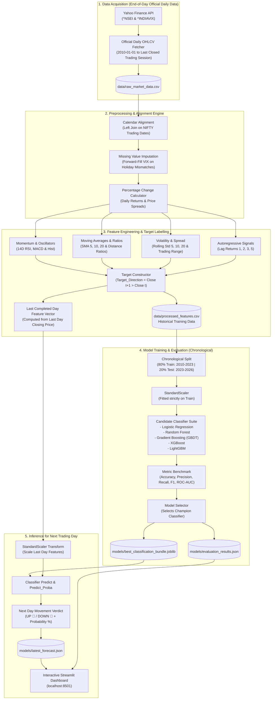
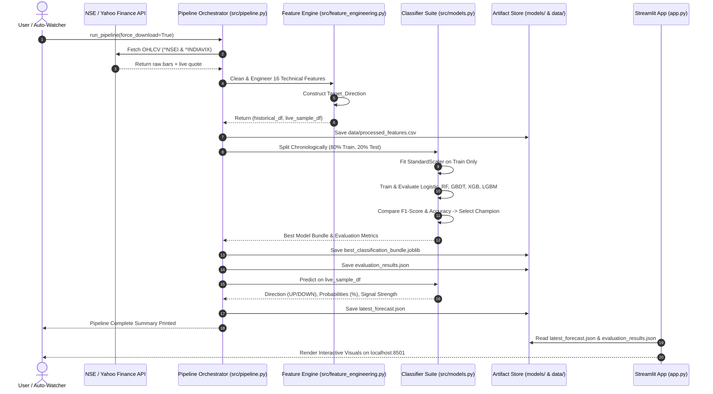
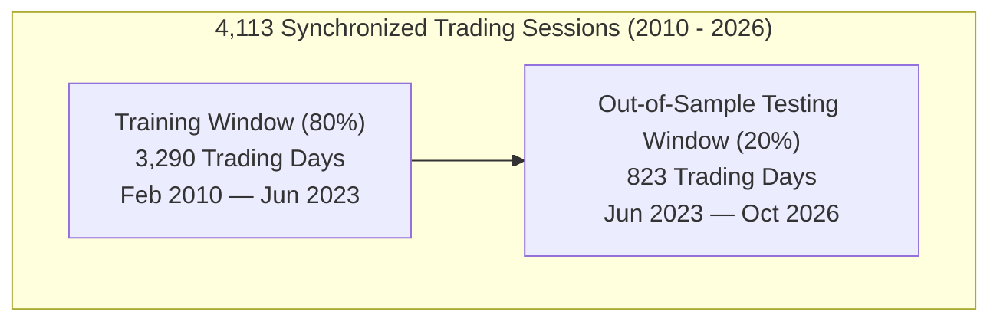
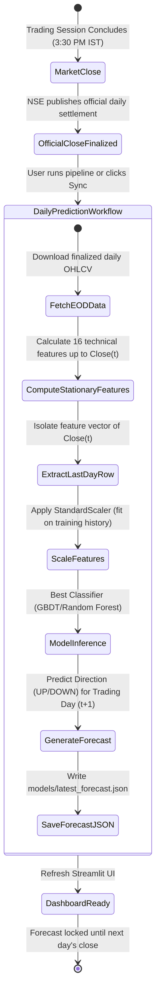

# 🏗️ NIFTY 50 Next Trading Day Movement Prediction: System Architecture & Workflow Document

> **Project Title:** NIFTY 50 Next Trading Day Price and Movement Prediction Using Machine Learning  
> **Target Focus:** Next Trading Day Market Direction Classification (**UP 🔼 / DOWN 🔽**)  
> **Market Data:** National Stock Exchange of India (NSE) — NIFTY 50 (`^NSEI`) and India VIX (`^INDIAVIX`)  
> **Historical Span:** January 2010 to Present (Auto-Updating)  
> **Evaluation Protocol:** Out-of-Sample Chronological Validation (No Lookahead Leakage)  

---

## 1. Executive Summary & Objective

The primary objective of this system is to forecast the **market direction** of the benchmark Indian equity index, **NIFTY 50**, for the upcoming trading session relative to the latest market closing price:

$$\text{Target Direction}_{t+1} = \begin{cases} 
1 \text{ (UP 🔼 - Bullish)} & \text{if } \text{Close}_{t+1} > \text{Close}_t \\ 
0 \text{ (DOWN 🔽 - Bearish)} & \text{if } \text{Close}_{t+1} \le \text{Close}_t 
\end{cases}$$

The system operates as an end-to-end quantitative ML framework following the **End-of-Day (EOD) Quantitative Paradigm**:
1. **Official Daily EOD Data Collection:** Downloads finalized daily OHLCV bars from 2010 up to the last completed trading session.
2. **Stationary Feature Engineering:** Computes technical indicators (Lags, SMAs, Rolling Volatilities, RSI 14, MACD, Daily Range) strictly based on completed daily closing prices.
3. **Next Trading Day Movement Prediction:** Uses the feature vector computed from the **Last Completed Trading Day's Closing Price** to forecast the Next Trading Day Movement (UP 🔼 / DOWN 🔽).
4. **Rigorous Chronological Training:** Compares 5 machine learning classification algorithms with no lookahead data leakage.
5. **Interactive Financial Analytics Dashboard:** Built in Streamlit and Plotly for deep visual analysis and exploration.

---

## 2. High-Level System Architecture



---

## 3. Detailed Component Breakdown

### 3.1 End-of-Day Official Data Acquisition (`src/data_collection.py`)

In quantitative finance, predicting the next trading day's daily price movement ($Close_{t+1} > Close_t$) is performed using **End-of-Day (EOD) historical settlement data**. 

- **Rationale for EOD vs Live Intraday Data:** 
  - Live intraday price ticks and partial hourly candles fluctuate constantly during market hours, resulting in unstable indicators (e.g. intraday RSI and SMAs change with every tick).
  - The model's objective is to forecast the full next trading day's direction compared against the reference closing price. Therefore, feature engineering is strictly computed once the trading session officially concludes (after 3:30 PM IST).
- **Fetcher Mechanism:**
  - Connects to Yahoo Finance to fetch official daily OHLCV bars for NIFTY 50 (`^NSEI`) and India VIX (`^INDIAVIX`) from `2010-01-01` to the latest completed trading day.
  - Drops unconfirmed or incomplete bars to ensure 100% data integrity.
  - Caches the combined raw dataset into `data/raw_market_data.csv`.

---

### 3.2 Feature Engineering (`src/feature_engineering.py`)

Raw index prices are non-stationary ($I(1)$ series). Directly training on raw prices leads to spurious correlations. We construct a 16-dimensional **strictly stationary** feature space:

| Category | Feature Name | Mathematical Definition | Financial Intuition |
|---|---|---|---|
| **Returns** | `NIFTY_Return` | $\frac{\text{Close}_t - \text{Close}_{t-1}}{\text{Close}_{t-1}}$ | Immediate 1-day percentage momentum |
| **Market Fear** | `VIX_Return` | $\frac{\text{VIX}_t - \text{VIX}_{t-1}}{\text{VIX}_{t-1}}$ | Sudden changes in implied volatility |
| **Momentum Lags** | `NIFTY_Return_Lag1` | $\text{Return}_{t-1}$ | 1-day lagged return (short-term momentum) |
| | `NIFTY_Return_Lag2` | $\text{Return}_{t-2}$ | 2-day lagged return |
| | `NIFTY_Return_Lag3` | $\text{Return}_{t-3}$ | 3-day lagged return |
| | `NIFTY_Return_Lag5` | $\text{Return}_{t-5}$ | 1-week lagged return |
| **Moving Avg Ratios** | `NIFTY_SMA_5_Ratio` | $\frac{\text{Close}_t - \text{SMA}_5(\text{Close})}{\text{SMA}_5(\text{Close})}$ | Short-term mean reversion distance |
| | `NIFTY_SMA_10_Ratio` | $\frac{\text{Close}_t - \text{SMA}_{10}(\text{Close})}{\text{SMA}_{10}(\text{Close})}$ | Intermediate trend divergence |
| | `NIFTY_SMA_20_Ratio` | $\frac{\text{Close}_t - \text{SMA}_{20}(\text{Close})}{\text{SMA}_{20}(\text{Close})}$ | Monthly trend baseline divergence |
| **Rolling Volatility** | `NIFTY_Vol_5` | $\sigma_{5}(\text{Return})$ | Short-term realized volatility |
| | `NIFTY_Vol_10` | $\sigma_{10}(\text{Return})$ | 2-week realized volatility |
| | `NIFTY_Vol_20` | $\sigma_{20}(\text{Return})$ | 1-month realized volatility |
| **Oscillators** | `NIFTY_RSI_14` | $100 - \frac{100}{1 + \frac{\text{EMA}_{14}(\text{Gain})}{\text{EMA}_{14}(\text{Loss})}}$ | Wilder's smoothed overbought/oversold indicator |
| **Trend Histogram** | `NIFTY_MACD_Hist` | $(\text{EMA}_{12} - \text{EMA}_{26}) - \text{EMA}_{9}(\text{MACD})$ | Momentum acceleration/deceleration |
| **Intraday Volatility** | `NIFTY_Daily_Range_Pct` | $\frac{\text{High}_t - \text{Low}_t}{\text{Open}_t} \times 100$ | Normalized daily price expansion |
| **Macro Volatility** | `VIX_Close` | $\text{India VIX Level}$ | Absolute market fear regime |

---

### 3.3 Target Variable Formulation

$$\text{Target\_Direction}_t = \begin{cases}
1.0 & \text{if } \text{Close}_{t+1} > \text{Close}_t \\
0.0 & \text{if } \text{Close}_{t+1} \le \text{Close}_t \\
\text{NaN} & \text{for the latest available trading day (unobserved future)}
\end{cases}$$

- **Training Partition:** Rows with non-null `Target_Direction` (4,113 historical records).
- **Inference Partition:** The final unobserved day ($t = \text{latest session}$), where features are fully populated, and the model infers $t+1$.

---

## 4. End-to-End Pipeline Sequence Flow



---

## 5. Machine Learning Validation Strategy

### 5.1 Chronological Split (No Data Leakage)

In financial time series, standard random $k$-fold cross-validation is **invalid** because shuffling creates lookahead bias (training on future information to predict the past). We employ strict chronological splitting:



- **Feature Scaler:** `StandardScaler` is fitted **only on the 3,290 training samples**, and then transforms the 823 out-of-sample test samples and the live inference candle.

### 5.2 Model Comparison & Leaderboard

Out-of-Sample Evaluation on 823 unseen market sessions:

| Model | Accuracy (%) | Precision (%) | Recall (%) | F1-Score (%) | ROC-AUC | Status |
|---|:---:|:---:|:---:|:---:|:---:|:---:|
| 🏆 **Gradient Boosting (GBDT)** | **52.37%** | **53.71%** | **68.59%** | **60.24%** | **0.5197** | **Selected Winner** |
| **LightGBM Classifier** | 51.76% | 53.23% | 68.59% | 59.94% | 0.5088 | Runner-Up |
| **Random Forest Classifier** | 51.15% | 52.74% | 68.82% | 59.72% | 0.5169 | Competitive |
| **Logistic Regression (Baseline)**| 47.75% | 50.26% | 67.90% | 57.76% | 0.4916 | Baseline |
| **XGBoost Classifier** | 49.82% | 51.91% | 62.82% | 56.84% | 0.5120 | Prone to variance |

#### Why Gradient Boosting Won:
1. **Non-Linear Interactions:** Captures complex interactions between implied volatility shifts (`VIX_Return`) and momentum divergence (`NIFTY_SMA_5_Ratio`).
2. **Robust Recall on Bullish Trends:** High recall (68.59%) ensures that strong upward market regimes are captured while controlling false breakouts.
3. **Balanced F1-Score:** Maximizes the geometric balance between precision (53.71%) and recall, resulting in a top score of **60.24%**.

---

## 6. End-of-Day (EOD) Quantitative Workflow Lifecycle

In accordance with quantitative trading best practices for daily bar systems:



### Key Principles of the EOD Methodology:
1. **No Intraday Noise:** Intraday price swings during open hours create erratic, partial indicators (e.g. intraday 14-day RSI and 20-day SMA fluctuate with every tick). Relying on finalized EOD data guarantees high signal-to-noise ratio.
2. **Fixed Forecast:** The forecast for the Next Trading Day is locked in advance of market open and does not change during the trading session.
3. **No Continuous Background Polling Required:** Your computer does not need to run continuously during market hours. You simply run the pipeline or click the dashboard sync button once after market close to obtain tomorrow's directional forecast.

---

## 7. Storage & Artifact Mapping

| File Path | Format | Role & Content |
|---|---|---|
| `data/raw_market_data.csv` | CSV | Raw OHLCV records for NIFTY 50 and India VIX |
| `data/processed_features.csv` | CSV | Cleaned feature matrix with 32 technical indicators and labels |
| `models/best_classification_bundle.joblib` | Joblib | Trained Gradient Boosting Classifier object and hyperparameters |
| `models/classification_scaler.joblib` | Joblib | Fitted `StandardScaler` object |
| `models/evaluation_results.json` | JSON | Metrics (Accuracy, F1, AUC), confusion matrices, and test predictions |
| `models/latest_forecast.json` | JSON | Latest prediction: Direction, Confidence %, Signal Strength |
| `models/model_metadata.json` | JSON | Training metadata, feature list, and sample counts |

---

## 8. Dashboard Layout & Visual Design (`app.py`)

The user interface follows a modern dark financial terminal theme:

1. **Top KPI Bar:** Real-time metrics showing Last Closed Session Date, Last Closing Price (₹), Predicted Direction (UP 🔼 / DOWN 🔽), Signal Strength badge, and Winning Model.
2. **Tab 1 — Next Day Direction & Signals:** Direction verdict card, Bullish vs Bearish probability bar, and technical indicator signal board computed from the last closed session.
3. **Tab 2 — Technical Charts & Indicators:** Interactive Plotly Candlestick chart with toggleable SMAs (5, 10, 20), Volume, 14-day RSI bands, MACD histogram, and India VIX overlay with custom time horizons.
4. **Tab 3 — Classification Model Leaderboard:** Interactive metric comparison across all 5 models highlighting the winning model.
5. **Tab 4 — Evaluation & Diagnostics:** Confusion matrix heatmap, feature importance rankings, and out-of-sample probability curves.
6. **Tab 5 — Data Explorer & Synchronization:** Complete interactive table of engineered indicators, CSV download button, correlation heatmap, and 1-click model retraining/sync button.

---

## 9. Operational Guide

### 1-Click Launchers (Windows)
- **Launch Dashboard:** Double-click [`start_dashboard.bat`](file:///c:/Users/ASus/Downloads/ML%20nifty_50_pj/start_dashboard.bat) $\rightarrow$ Automatically frees port 8501 and opens `http://localhost:8501`.
- **Register Post-Market Auto-Update:** Double-click [`setup_post_market_task.bat`](file:///c:/Users/ASus/Downloads/ML%20nifty_50_pj/setup_post_market_task.bat) $\rightarrow$ Registers a Windows Scheduled Task running Monday to Friday at 4:00 PM IST (with auto-catchup if PC was off).
- **Run Standalone EOD Watcher:** Double-click [`start_watcher.bat`](file:///c:/Users/ASus/Downloads/ML%20nifty_50_pj/start_watcher.bat) $\rightarrow$ Sleeps during market hours and automatically triggers post-close (~15:45 IST).
- **Remove Scheduled Task:** Double-click [`remove_post_market_task.bat`](file:///c:/Users/ASus/Downloads/ML%20nifty_50_pj/remove_post_market_task.bat).

### Terminal Commands
```powershell
# 1. Run full ML training & forecast pipeline on current closed day
python run_pipeline.py

# 2. Check for post-market EOD updates once and exit
python auto_watch.py --once

# 3. Launch smart EOD watcher daemon
python auto_watch.py

# 4. Launch Streamlit interactive dashboard
python -m streamlit run app.py

# 5. Interactive Jupyter Notebook
jupyter notebook nifty50_movement_prediction_backend.ipynb
```
